# Lab7Web_PHP - Pemrograman Server-Side dengan PHP

**Nama:** Naifah Alya Kamilah

**NIM:** 312510193

**Kelas:** I251B

**Mata Kuliah:** Pemrograman Web (Praktikum 7, Pertemuan 9)

## Tujuan Praktikum

1. Memahami perbedaan pemrosesan client-side dan server-side.
2. Menjalankan file PHP melalui server lokal (XAMPP).
3. Menggunakan variabel, operator, percabangan, perulangan, array, dan function pada PHP.
4. Memproses data dari form HTML menggunakan metode GET dan POST.
5. Melakukan validasi dan sanitasi input dasar di sisi server sebelum data ditampilkan.
6. Membangun aplikasi sederhana yang menerima, memproses, dan menampilkan data pengguna.

## Struktur File

```
Lab7Web_PHP/
├── index.php            # Latihan 1: Menjalankan PHP
├── latihan2.php         # Latihan 2: Variabel, operator, percabangan
├── latihan3.php         # Latihan 3: Perulangan dan array
├── latihan4.php         # Latihan 4: Function
├── cari.php             # Latihan 5: Form GET
├── latihan6.php         # Latihan 6: Form POST
├── latihan7.php         # Latihan 7: Pengolahan data sederhana
├── miniProject.php      # Mini Project: Formulir Data Mahasiswa
├── eksperimen.php       # Eksperimen mandiri
├── README.md            # Dokumentasi
└── screenshot/          # Screenshot hasil praktikum
```

Latihan 6 memakai nama `latihan6.php` karena `index.php` sudah dipakai untuk Latihan 1.

## Cara Menjalankan

1. Salin folder `Lab7Web_PHP` ke direktori web server, yaitu `C:\xampp\htdocs\`.
2. Buka XAMPP Control Panel, lalu klik **Start** pada Apache.
3. Buka browser dan akses `http://localhost/Lab7Web_PHP/` atau `http://localhost/Lab7Web_PHP/nama_file.php`.
4. File PHP tidak boleh dibuka dengan klik dua kali karena harus diproses oleh server. Jika dibuka langsung, kode PHP tidak dijalankan.

## Langkah Kerja

### Latihan 1 - Menjalankan PHP

Halaman `index.php` menampilkan teks "PHP berhasil dijalankan." melalui `echo` dan waktu server melalui fungsi `date()`. Pada percobaan pertama waktu server menunjukkan 07:34, padahal jam komputer 13:34, karena zona waktu bawaan XAMPP bukan WIB. Masalah diselesaikan dengan menambahkan `date_default_timezone_set("Asia/Jakarta");` sebelum `echo`.

| Sebelum diatur zona waktu | Sesudah diatur zona waktu |
|---|---|
| 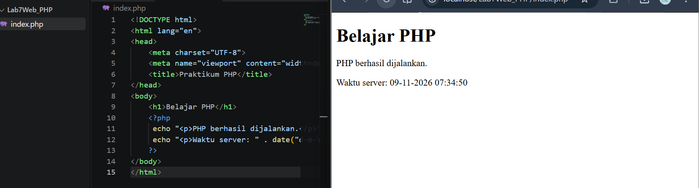 | 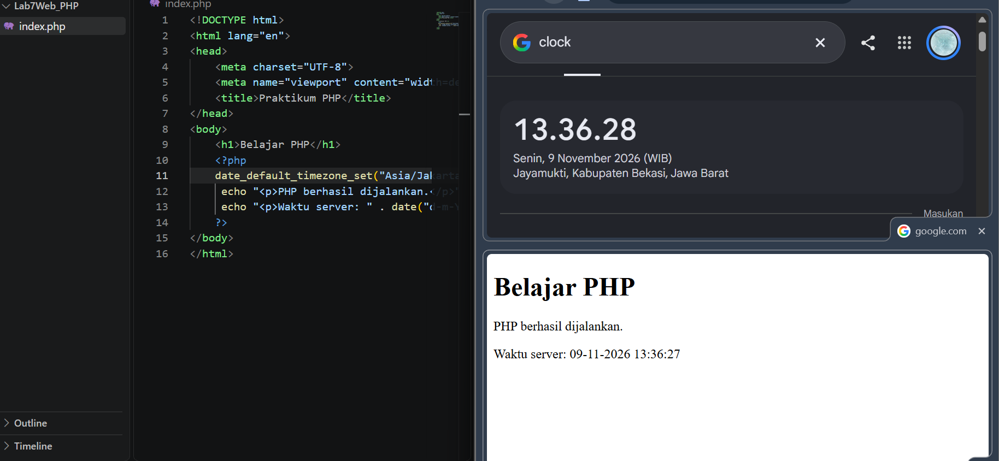 |

### Latihan 2 - Variabel, Operator, dan Percabangan

Nilai akhir dihitung dengan bobot tugas 30%, UTS 30%, dan UAS 40%, kemudian predikat ditentukan memakai `if / elseif / else`. `number_format()` dipakai agar nilai tampil dua angka desimal, dan `htmlspecialchars()` dipakai saat menampilkan nama. Pengujian dilakukan dengan empat kombinasi nilai sehingga seluruh cabang percabangan terbukti berjalan.

| Tugas | UTS | UAS | Nilai Akhir | Predikat | Screenshot |
|---|---|---|---|---|---|
| 85 | 78 | 90 | 84,90 | B | 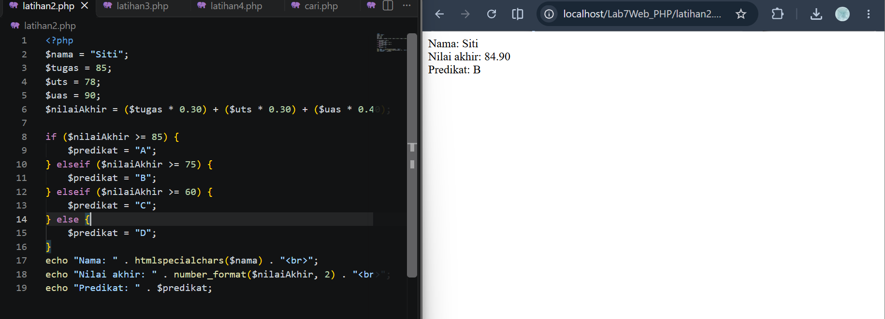 |
| 55 | 78 | 75 | 69,90 | C | 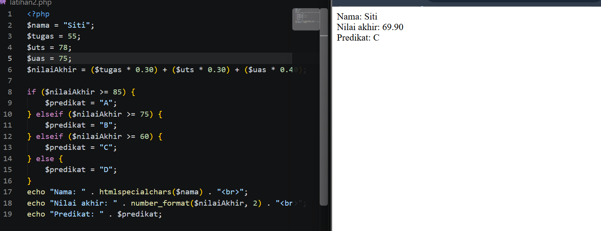 |
| 90 | 95 | 80 | 87,50 | A | 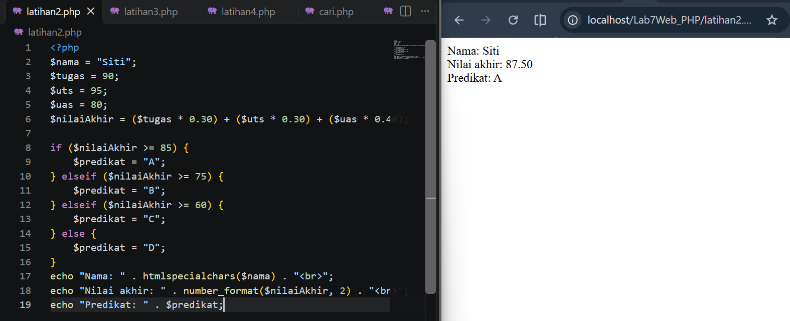 |
| 30 | 40 | 44 | 38,60 | D | 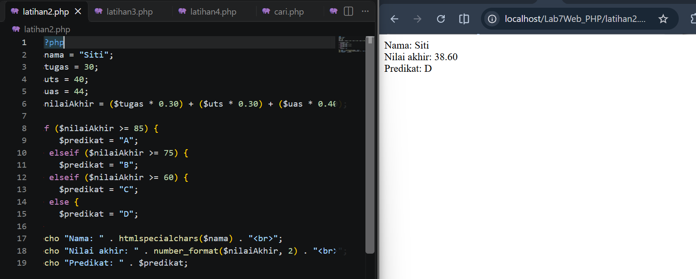 |

### Latihan 3 - Perulangan dan Array

Data mahasiswa disimpan dalam array, lalu ditampilkan dengan `foreach` sebagai daftar bernomor (`<ol>`). Data awal berisi empat nama, kemudian ditambah menjadi tujuh nama sesuai ketentuan modul. Sebagai eksperimen tambahan, `count()` dipakai untuk menampilkan jumlah mahasiswa.

| Empat nama (awal) | Tujuh nama |
|---|---|
| 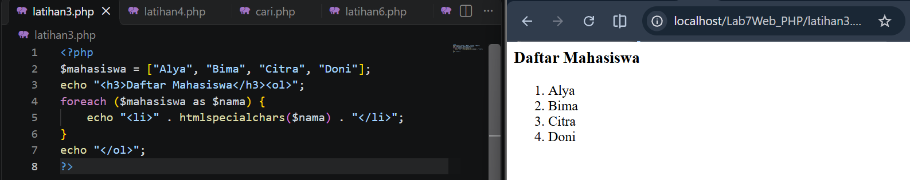 | 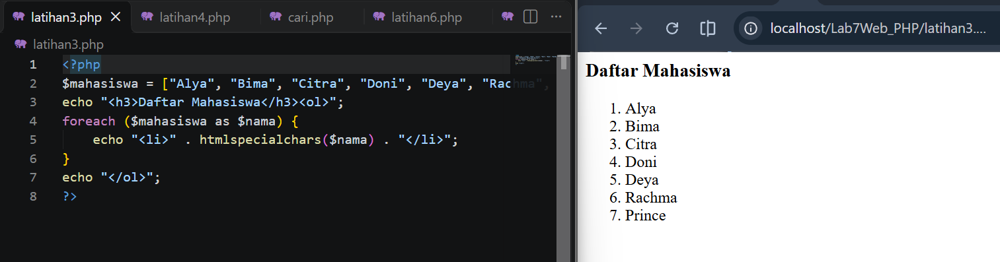 |

**Dengan penghitung jumlah (`count()`):**

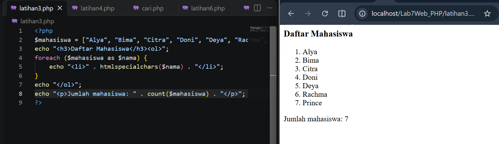

### Latihan 4 - Function

Function `hitungDiskon($harga, $persen)` mengembalikan harga setelah diskon. Untuk harga 150.000 dengan diskon 10% hasilnya Rp135.000. Sesuai ketentuan modul, ditambahkan dua function baru: `hitungLuasPersegiPanjang()` yang menghasilkan 1748 untuk ukuran 76 x 23, dan `tentukanKelulusan()` yang menghasilkan "Tidak Lulus" untuk nilai 60 (batas lulus 70).

| Function `hitungDiskon()` | Dengan dua function tambahan |
|---|---|
| 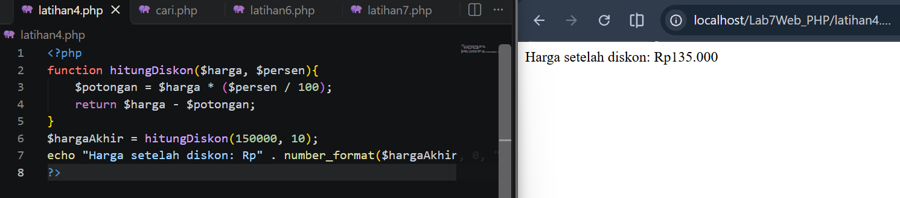 | 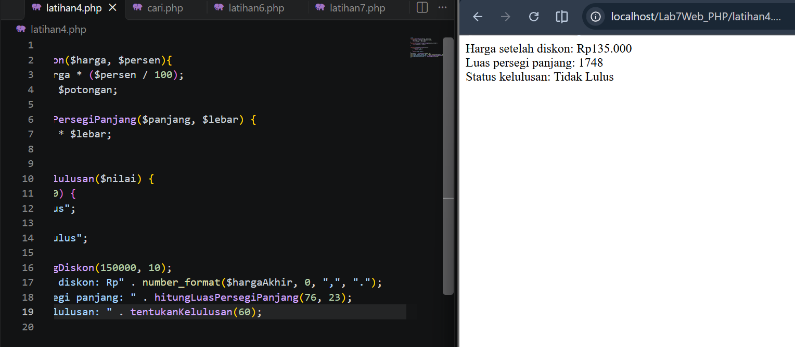 |

### Latihan 5 - Memproses Form dengan GET

Form memakai `method="GET"` sehingga data dikirim lewat parameter URL dan dibaca dengan `$_GET["kata"]`. `isset()` dipakai agar tidak terjadi error ketika form belum dikirim, `trim()` membersihkan spasi, dan `htmlspecialchars()` mengamankan output. Setelah kata kunci "Table" dikirim, alamat berubah menjadi `cari.php?kata=Table`. Karena data terlihat di URL, GET tidak boleh dipakai untuk kata sandi atau data sensitif.

| Sebelum dikirim | Sesudah dikirim |
|---|---|
| 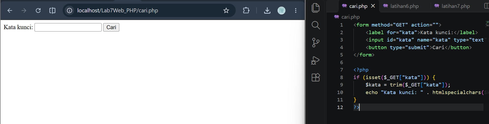 | 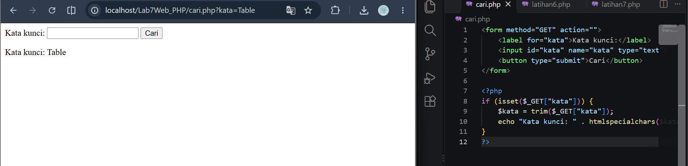 |

### Latihan 6 - Memproses Form dengan POST

Form memakai `method="POST"` sehingga data dikirim lewat body request dan alamat tidak berubah. Data dibaca dengan `$_POST` dan operator `??` agar aman bila kunci tidak ada, lalu divalidasi setelah `trim()`. Pengujian dilakukan pada tiga kondisi:

| Kondisi | Hasil | Screenshot |
|---|---|---|
| Data lengkap (Naifah A, Teknik Informatika) | "Data diterima" dan data ditampilkan | 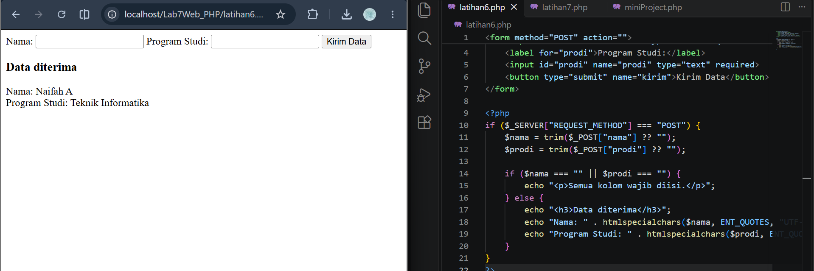 |
| Nama berisi tag HTML `<b>Nai</b>` | Tampil sebagai teks apa adanya, bukan huruf tebal, karena `htmlspecialchars()` | 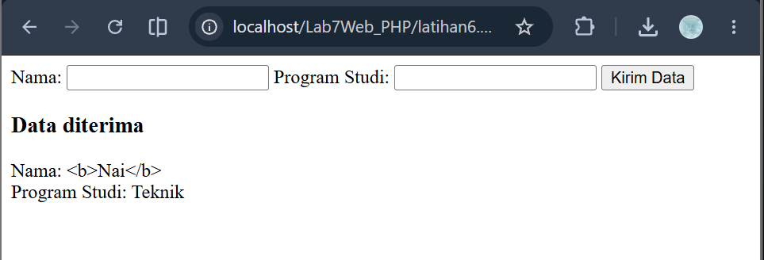 |
| Kedua kolom hanya berisi spasi | Semua kolom wajib diisi. | 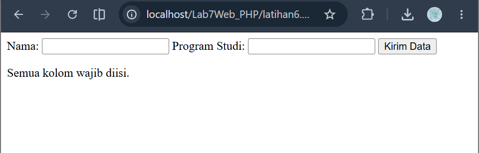 |

Pada pengujian kolom kosong, atribut `required` di browser lolos karena spasi dianggap isian, tetapi `trim()` mengubahnya menjadi string kosong sehingga validasi PHP yang menolaknya.

### Latihan 7 - Pengolahan Data Sederhana

Form menerima nama barang, harga, dan jumlah, lalu PHP menghitung subtotal. Validasi di PHP memeriksa nama tidak kosong (`trim()`), harga berupa angka (`is_numeric()`), jumlah berupa bilangan bulat positif (`ctype_digit()`), serta harga tidak negatif dan jumlah minimal 1.

Atribut `min`, `step`, dan `required` pada HTML ternyata sudah memblokir input salah lebih dulu, sehingga pesan error PHP tidak pernah muncul. Untuk menguji validasi PHP, atribut `novalidate` ditambahkan sementara pada tag `<form>`. Tiga input tidak valid diuji, yaitu jumlah 0, jumlah -2, dan harga -5000, dan ketiganya menghasilkan pesan yang sama dari PHP. Setelah pengujian, `novalidate` dihapus kembali.

| Input valid (harga desimal) | Input tidak valid (validasi PHP) |
|---|---|
| 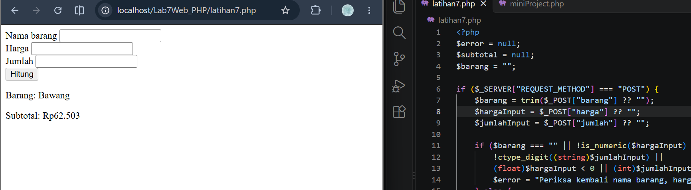 | 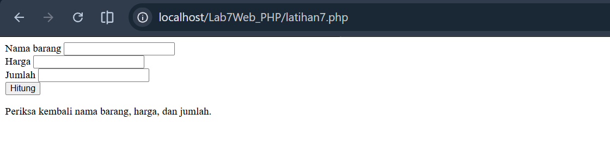 |

Pada input valid, subtotal tampil Rp62.503 karena `number_format()` membulatkan hasil perkalian harga desimal.

## Mini Project - Formulir Data Mahasiswa

File `miniProject.php` berisi form dengan kolom nama, NIM, program studi, semester, dan email yang dikirim dengan POST. Pemrosesan data dan validasi berada di bagian atas file, sedangkan tampilan HTML berada di bagian bawah.

Aturan validasi server-side:

1. Nama, NIM, dan program studi wajib diisi.
2. NIM harus berupa 9 digit angka (`ctype_digit()` dan `strlen()`).
3. Email harus valid, diperiksa dengan `filter_var($email, FILTER_VALIDATE_EMAIL)`.
4. Semester harus bilangan bulat 1 sampai 14.
5. Seluruh pesan kesalahan ditampilkan sekaligus, sedangkan isian pengguna tetap terisi kembali lewat atribut `value`.
6. Data yang lolos ditampilkan dalam tabel ringkasan, dengan `htmlspecialchars()` pada setiap nilai.

Kolom email sengaja memakai `type="text"` (bukan `type="email"`) agar validasi dari PHP dapat diperlihatkan dan tidak diblokir lebih dulu oleh browser.

**Pengisian benar (semester 3):**

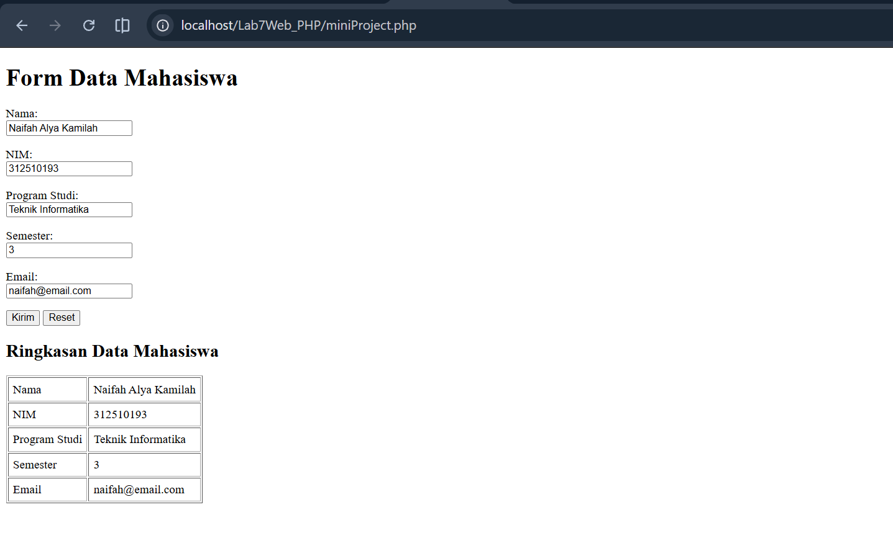

**Pengujian input tidak valid:**

| Kasus | Hasil | Screenshot |
|---|---|---|
| Semester 15 | Semester harus berupa angka 1-14. | 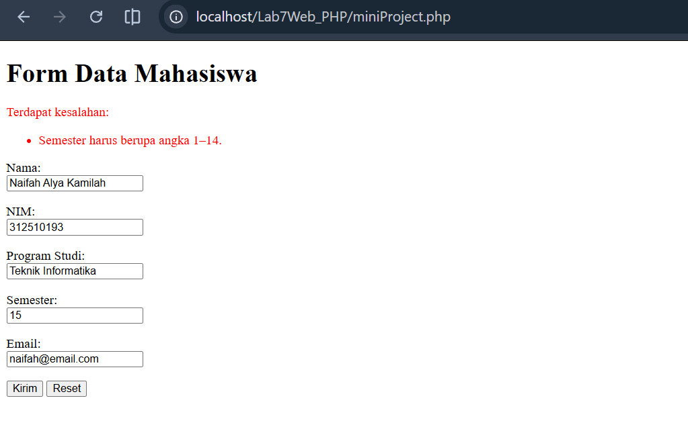 |
| Email `naifah@` | Format email tidak valid. | 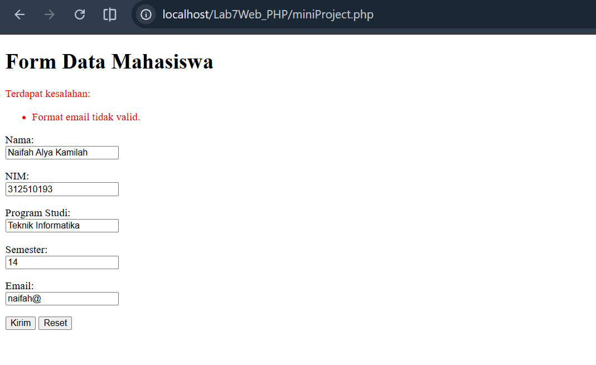 |
| Nama dan program studi kosong, email `naifah@` | Tiga pesan kesalahan tampil sekaligus (nama, program studi, email) | 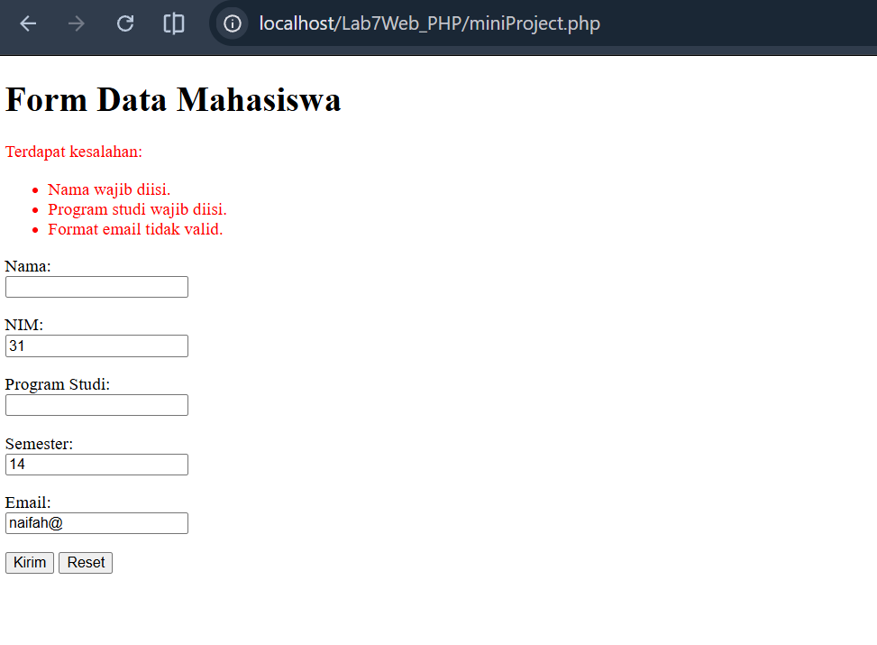 |
| NIM `31` | NIM harus berupa 9 digit angka. | 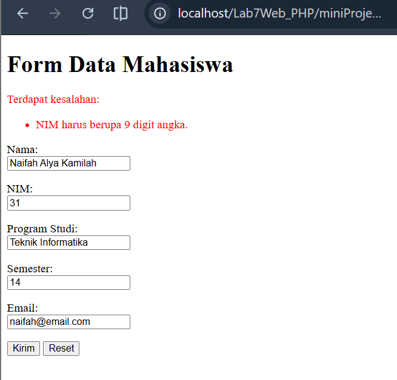 |
| NIM `31251019a` (ada huruf) | NIM harus berupa 9 digit angka. | 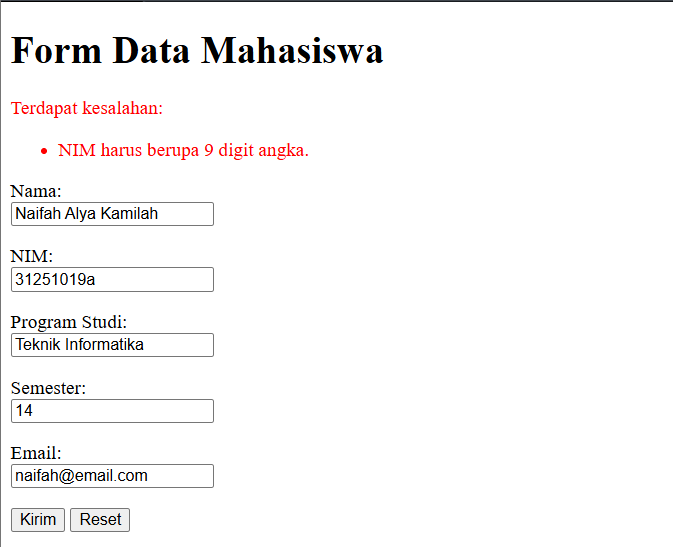 |

## Kasus Uji Input

Ringkasan kasus input valid dan tidak valid dari seluruh latihan:

| No | Kasus | Input | Hasil |
|---|---|---|---|
| 1 | Valid | Latihan 6: Naifah A dan Teknik Informatika | Data diterima dan ditampilkan |
| 2 | Valid | Mini Project: Naifah Alya Kamilah, NIM 312510193, semester 3, naifah@email.com | Ringkasan data tampil |
| 3 | Tidak valid | Latihan 7: jumlah 0, jumlah -2, atau harga -5000 | Periksa kembali nama barang, harga, dan jumlah. |
| 4 | Tidak valid | Mini Project: email `naifah@` atau semester 15 | Pesan kesalahan sesuai kolom |
| 5 | Tidak valid | Mini Project: NIM `31` atau `31251019a` | NIM harus berupa 9 digit angka. |

## Eksperimen Mandiri

| No | Eksperimen | Keterangan |
|---|---|---|
| 1 | Rata-rata tiga komponen nilai | Dikerjakan pada `eksperimen.php`, nilai 85, 78, 90 menghasilkan 84,33 |
| 2 | Contoh GET untuk mencari nama dari array | Dikerjakan pada `eksperimen.php` |
| 3 | Function untuk format Rupiah | Function `formatRupiah()` pada `eksperimen.php` |
| 4 | Validasi NIM angka dan panjang | Dikerjakan pada Mini Project (NIM 9 digit angka) |
| 5 | Tombol reset pada form | Tombol Reset pada Mini Project, penjelasan di bawah |

**Eksperimen 2 - pencarian nama.** Kata kunci dicocokkan dengan `stripos()` (tanpa membedakan huruf besar kecil) pada tujuh nama dalam array. Kata kunci `a` menemukan lima nama (Alya, Bima, Citra, Deya, Rachma), `Dey` menemukan Deya, dan `xyz` menampilkan "Tidak ada nama yang cocok."

| Kata kunci `a` | Kata kunci `Dey` | Kata kunci `xyz` |
|---|---|---|
| 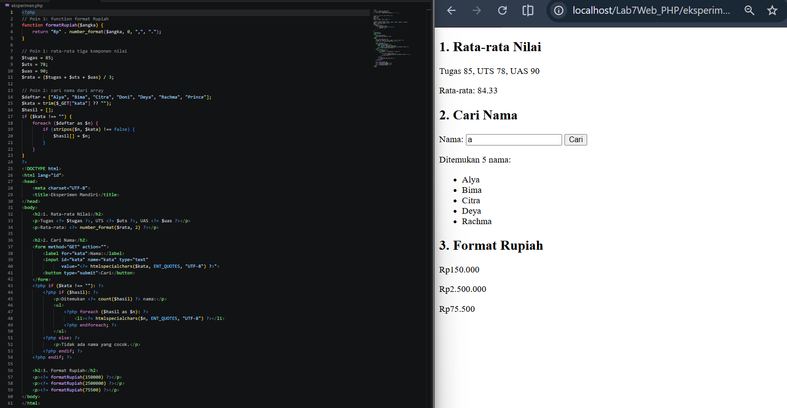 | 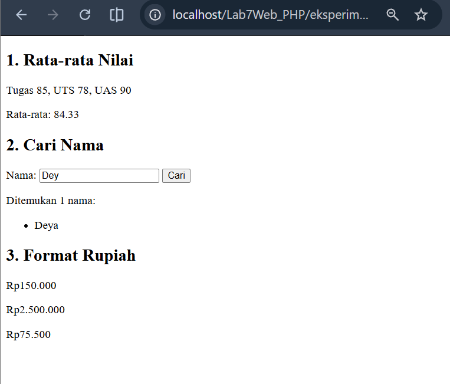 | 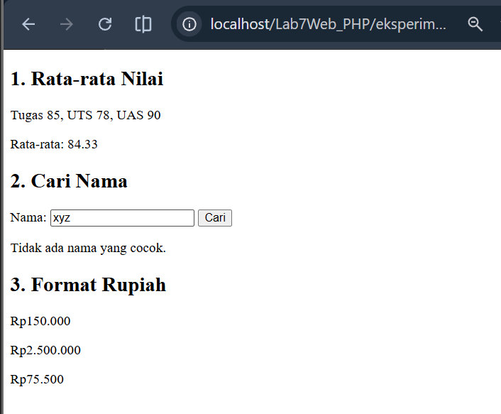 |

**Eksperimen 3 - format Rupiah.** Function `formatRupiah($angka)` menggabungkan awalan "Rp" dengan `number_format($angka, 0, ",", ".")`. Nilai 150000 tampil Rp150.000, 2500000 tampil Rp2.500.000, dan 75500 tampil Rp75.500 (terlihat pada screenshot eksperimen di atas).

**Penjelasan eksperimen 5.** Tombol Reset (`type="reset"`) hanya bekerja di browser, yaitu mengembalikan isian form ke nilai awalnya tanpa mengirim apa pun ke server. Tombol Kirim mengirim data ke server dengan POST, lalu PHP memproses ulang dan membuat halaman baru. Karena kolom form diisi ulang dari PHP lewat atribut `value`, setelah pengiriman yang gagal "nilai awal" form adalah isian yang baru dikirim, sehingga Reset mengembalikan isian itu dan tidak mengosongkannya.

## Jawaban Pertanyaan Evaluasi

Jawaban pertanyaan evaluasi (nomor 1-7) tersedia pada file PDF `Jawaban_Praktikum_7_PHP_Server_Side.pdf`.
